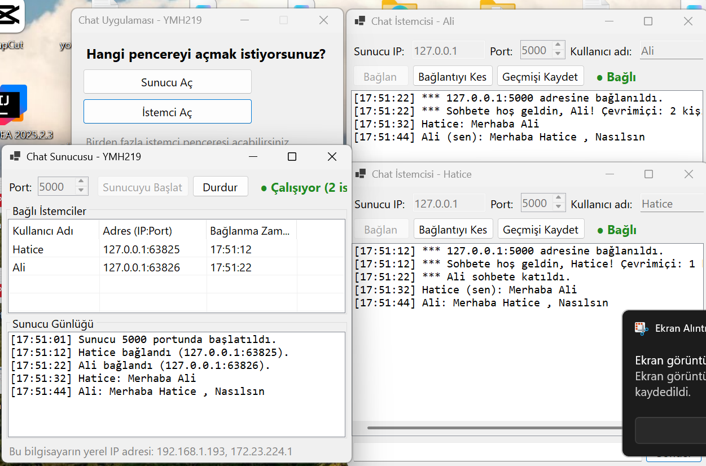
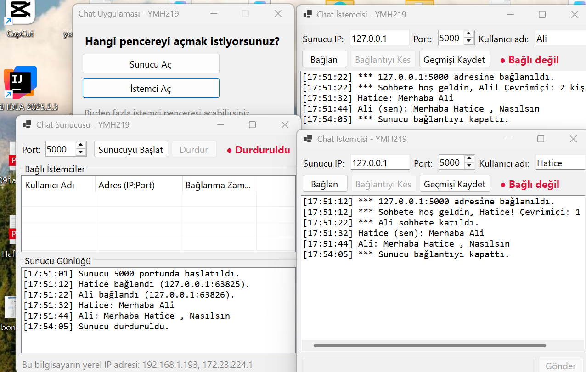

# YMH219 - İstemci-Sunucu Chat Uygulaması

Nesne Tabanlı Programlama (YMH 219) dersi kapsamında C# ve Windows Forms ile geliştirilmiş, TCP/IP üzerinden çalışan bir istemci-sunucu sohbet uygulamasıdır. Aynı bilgisayarda veya aynı yerel ağda çalışan bir sunucuya birden fazla istemci kullanıcı adıyla bağlanabilir ve aynı sohbet odasında mesajlaşabilir.

## Geliştirici
- **Ad Soyad:** Hatice Kırmızıgül
- **Öğrenci No:** 250541102

## Kullanılan Teknolojiler
- C#
- .NET 10 (Windows Forms)
- `TcpListener` / `TcpClient` ile TCP/IP iletişimi
- `StreamReader` / `StreamWriter` (NetworkStream üzerinde)
- `async` / `await` ile asenkron ağ işlemleri
- `System.Text.Json` ile mesaj serileştirme
- Visual Studio
- Harici NuGet paketi kullanılmamıştır.

## Kurulum ve Çalıştırma
1. Depoyu klonlayın:
   `git clone https://github.com/Hatice711/YMH219-ChatApp.git`
2. `ChatApp.slnx` dosyasını Visual Studio ile açın.
3. **F5** tuşuna basarak projeyi çalıştırın.
4. Açılan başlangıç penceresinden:
   - **Sunucu Aç** → port seçin (varsayılan 5000) → **Sunucuyu Başlat**
   - **İstemci Aç** → sunucu IP adresi, port ve kullanıcı adını girin → **Bağlan**
5. Birden fazla istemci penceresi açarak mesajlaşmayı deneyebilirsiniz.

> **Aynı bilgisayarda:** sunucu IP olarak `127.0.0.1` kullanın.
> **Aynı yerel ağda:** sunucu penceresinin altında yazan yerel IP adresini (ör. `192.168.x.x`) kullanın. İlk çalıştırmada Windows Güvenlik Duvarı izin isteyebilir.

> Gereksinim: Windows işletim sistemi ve .NET 10 SDK.

## Özellikler
**Sunucu**
- Belirtilen portta bağlantı bekleme, başlatma / durdurma
- Bağlı istemcilerin listesi: kullanıcı adı, IP:port ve bağlanma zamanı
- Zaman bilgili sunucu günlüğü (bağlanma, ayrılma, mesajlar)
- Gelen mesajları diğer tüm istemcilere iletme (ortak sohbet odası)
- Aynı kullanıcı adıyla ikinci bağlantının reddedilmesi
- Yerel IP adresinin gösterilmesi

**İstemci**
- Sunucu IP, port ve kullanıcı adı ile **Bağlan**
- **Mesaj Gönder** (Enter tuşu ile de gönderilebilir)
- **Bağlantıyı Kes**
- Gönderilen ve alınan mesajların zaman bilgisiyle gösterilmesi
- Bağlantı durumu göstergesi (Bağlı / Bağlı değil)
- Mesaj geçmişinin `.txt` dosyasına kaydedilmesi

**Hata Yönetimi**
- Sunucu kapalıyken bağlanma denemesinde anlaşılır hata mesajı
- 5 saniyelik bağlantı zaman aşımı
- Sunucu durdurulduğunda veya bağlantı koptuğunda istemcinin kapanmadan durumu bildirmesi
- Port kullanımdaysa sunucunun hata mesajı vermesi
- Bozuk / geçersiz veri geldiğinde mesajın yok sayılması

## Sınıf Yapısı
| Sınıf | Görevi |
|---|---|
| `ChatMessage` | Mesaj modeli ve protokol (Join / Chat / System / Leave), JSON dönüşümü |
| `ChatServer` | `TcpListener` ile bağlantı kabulü, istemci yönetimi ve mesaj dağıtımı |
| `ClientConnection` | Sunucu tarafında bağlı tek bir istemcinin bağlantısı ve bilgileri |
| `ChatClient` | İstemci tarafında `TcpClient` ile bağlanma, mesaj gönderme / alma |
| `ChatHistoryService` | Mesaj geçmişinin `StreamWriter` ile dosyaya yazılması |
| `StartForm` | Sunucu veya istemci penceresi açmak için başlangıç ekranı |
| `ServerForm` | Sunucu arayüzü |
| `ClientForm` | İstemci arayüzü |

## İletişim Protokolü
Her mesaj tek satırlık bir JSON metni olarak gönderilir, böylece alıcı taraf `ReadLineAsync` ile her seferinde tam olarak bir mesaj okur:

```json
{"Type":1,"Sender":"Hatice","Text":"Merhaba","Time":"2026-11-25T17:51:32"}
```

## Ekran Görüntüleri
### Sunucu ve İki İstemci Mesajlaşırken


### Sunucu Durdurulduğunda (Hata Yönetimi)


## Bilinen Sınırlamalar / Geliştirme Notları
- Tüm istemciler tek bir ortak sohbet odasındadır; özel mesaj özelliği yoktur.
- Mesajlar şifrelenmeden gönderilir; yalnızca yerel ağ ve ders amaçlı kullanım içindir.
- Sunucu mesaj geçmişini saklamaz; sonradan bağlanan istemci önceki mesajları göremez.
- Sunucu ve istemci aynı uygulama içindedir; başlangıç penceresinden istenen rol seçilir.
